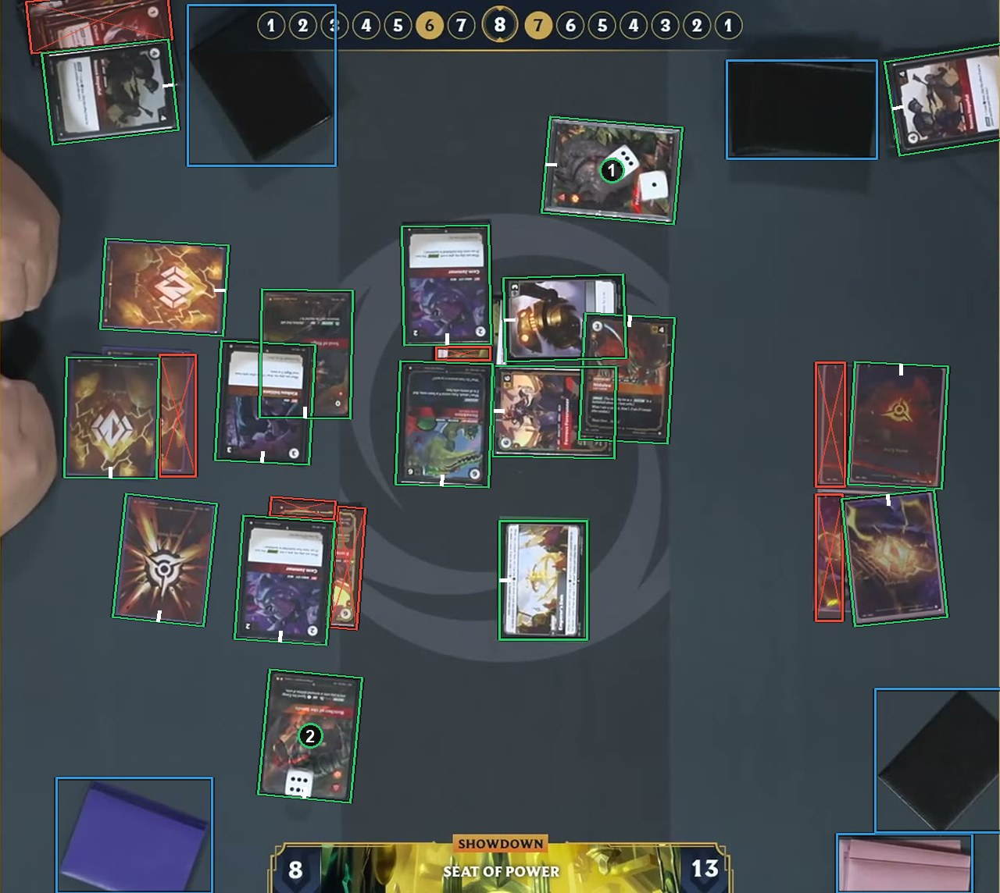

# Small things on a card

A die, a counter, a fingertip or the edge of another card does not change what the card is. Draw a card box around the whole card, including the part under the small thing. See [How to label](https://github.com/ryangswe/riftsight-vision/blob/main/docs/labeling.md#small-things-on-a-card).

Box 1 has two dice on it, and box 2 has one. Both are card boxes around the whole card, under the dice. The dice get no box.
