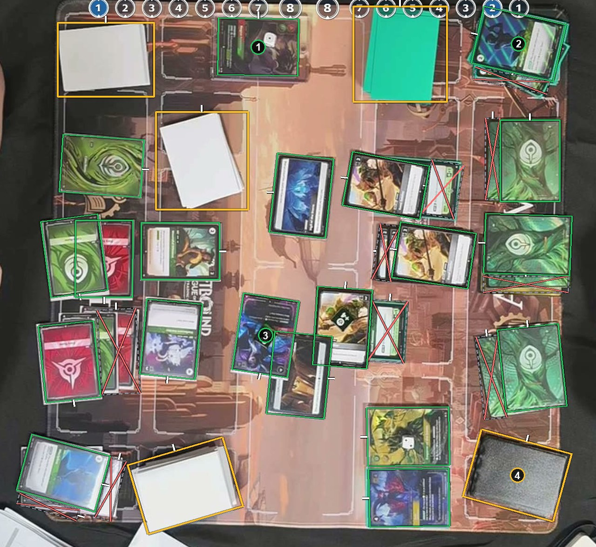

# Which way up

A box turns with its card. The white tick marks the card's own top. Card backs and ignore boxes have a tick too, but their orientation does not matter: do not spend time on it. See [How to label](https://github.com/ryangswe/riftsight-vision/blob/main/docs/labeling.md#which-way-up).

Box 1 sits upright, so its tick is on the top edge. Box 2 is turned sideways and tilted, and its tick is on the side where the card's top is now. Box 3 is upside down and tilted, so its tick is near the bottom of the screen. Box 4 is a deck: a back box, whose tick does not matter.
