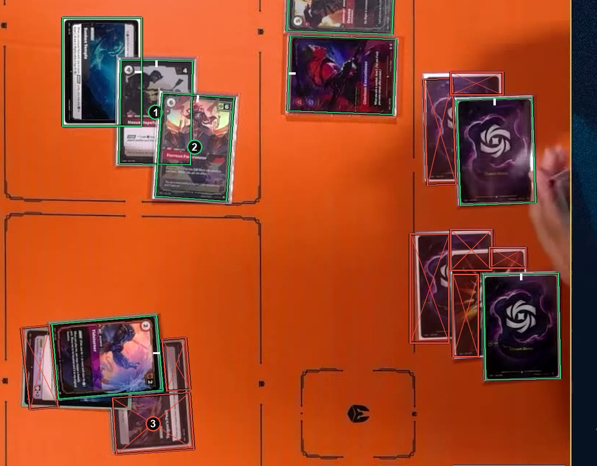
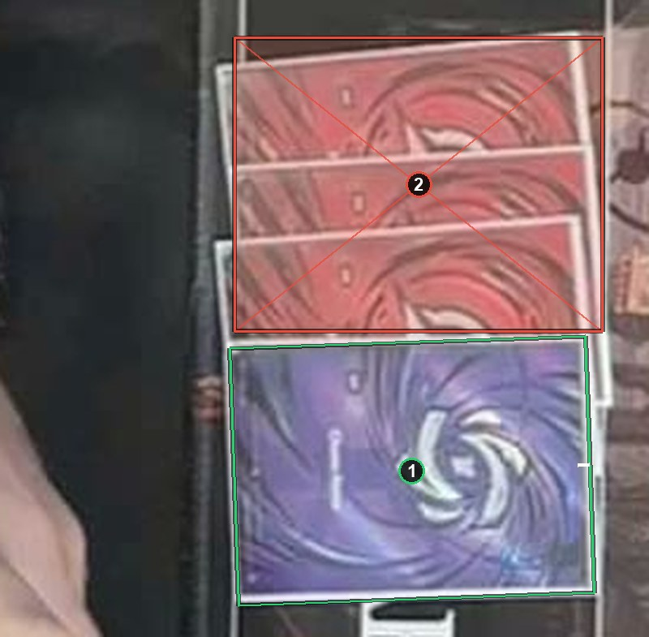

# Overlapping cards

Judge each card by what you can see. Less than about half hidden: a card box around the whole card. About half or more hidden: an ignore box around the visible part. Strips that lie together may share one ignore box. See [How to label](https://github.com/ryangswe/riftsight-vision/blob/main/docs/labeling.md#stacks-fans-and-rows).

Box 1 is about a third hidden under box 2, so it gets a card box around its whole outline. Box 2 is on top and gets a card box too. Box 3 is mostly hidden under the card above it, so its ignore box covers just the part you can see. The thin red strips on the right are cards under other cards, each boxed to its visible part.

Three cards are stacked under box 1, and each shows a strip. Box 1 shows its whole face and gets a card box. Box 2 is one ignore box around all three strips, which is quicker than three and teaches the same thing.
