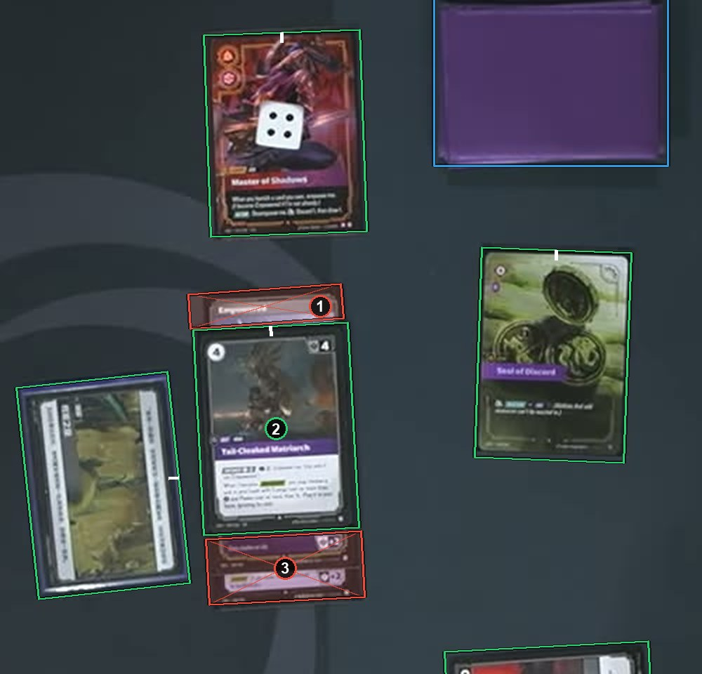

# A covered card whose name still shows

A card mostly hidden under another card is an ignore box, even when you can still read its name. A full box there would cover the top card's picture, and a recognizer would learn that picture under the wrong name. See [How to label](https://github.com/ryangswe/riftsight-vision/blob/main/docs/labeling.md#stacks-fans-and-rows).

The strip in box 1 is the edge of a card under box 2, and its name can still be read. Most of its outline would show box 2's picture, so it gets an ignore box around the strip. Box 3 holds the strips of two more cards under box 2, in one ignore box.
