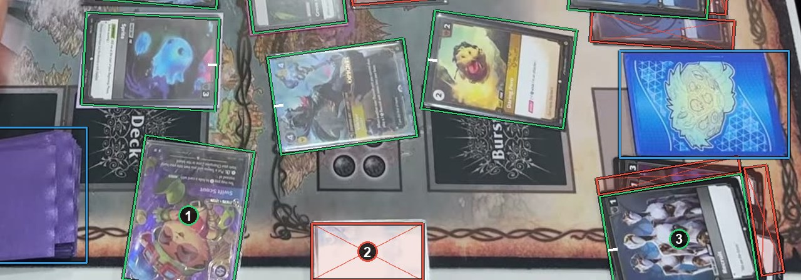

# The frame's edge

Most of the card in the frame: a card box around the whole card, running past the edge. About half or less in the frame: an ignore box around the visible part. See [How to label](https://github.com/ryangswe/riftsight-vision/blob/main/docs/labeling.md#the-frames-edge).

The bottom of this picture is the bottom of the frame. Box 1 and box 3 are mostly in the frame, so their card boxes run past the edge and keep the cards' true size and angle. Box 2 shows less than half of its card, washed out by glare, so it gets an ignore box around what you can see.
