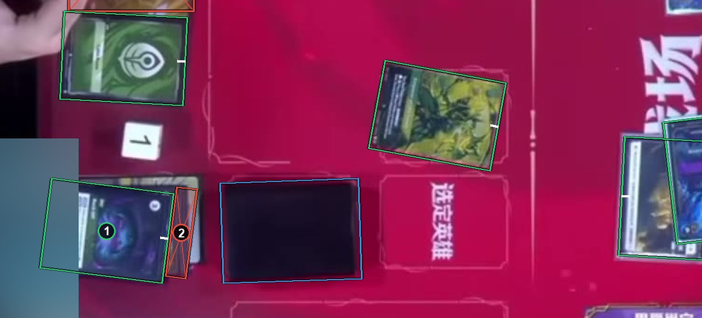
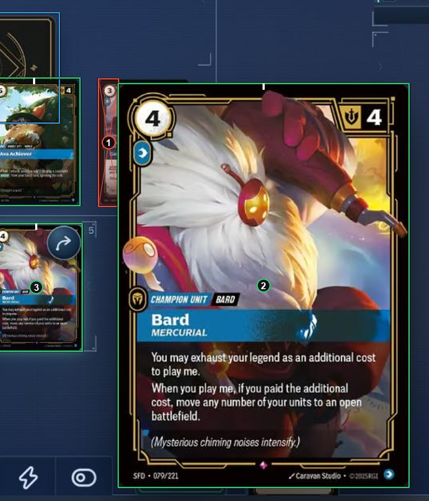

# The interface, overlays and webcams

A card covered by the game's interface, a broadcast overlay or a webcam follows the same rule as a card covered by another card. The interface, the overlay and the webcam get no box. See [How to label](https://github.com/ryangswe/riftsight-vision/blob/main/docs/labeling.md#the-interface-overlays-and-webcams).

The plain block at the bottom left is a webcam, blurred for this page. Box 1 is less than half hidden under it, so its card box runs under the webcam around the whole card. Box 2 is the strip of a card under box 1: an ignore box.

In this digital client, the enlarged hover card (box 2) covers part of the board. Box 1 is a card mostly hidden behind it, so its ignore box covers just the strip you can see. Cards hidden completely behind box 2 get no box at all, because nothing of them shows. Box 3 is the card being hovered.

*The saved labels for this frame follow an older rule, so the boxes in this picture were redrawn for this guide.*
