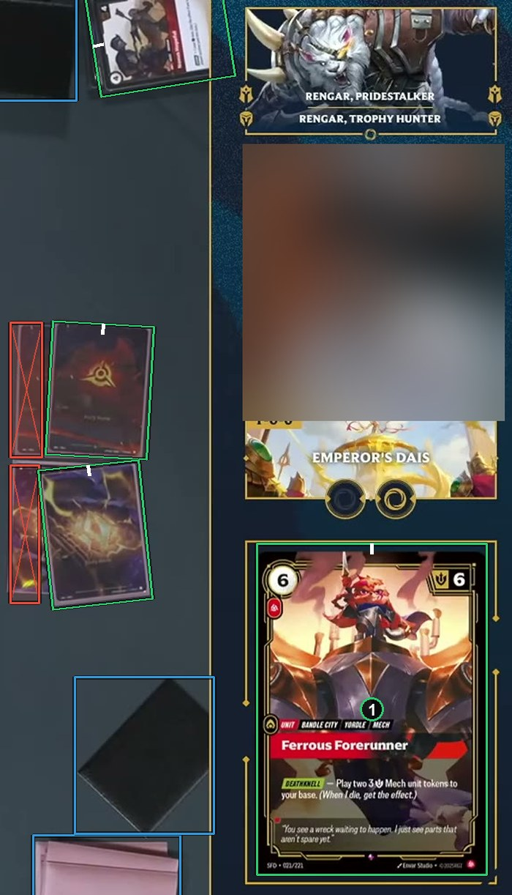
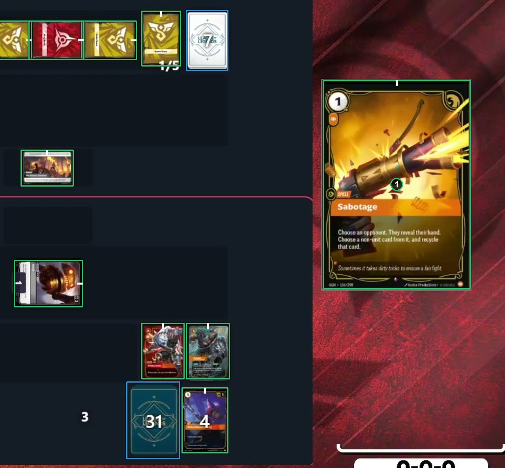

# Cards shown enlarged

A whole card face shown enlarged, in a client's hover preview or a panel of the broadcast, gets a card box like the other cards. Cropped art in the layout, such as a portrait, a banner or a name plate, gets none. See [How to label](https://github.com/ryangswe/riftsight-vision/blob/main/docs/labeling.md#cards-shown-enlarged).

Box 1 is a whole card shown in the broadcast's side panel: a card box. The portrait at the top and the banner above box 1 are cropped art, not card faces, so they get no box. The blurred block between them is a webcam.

Box 1 is the client's hover preview of a card, shown large beside the board. It gets a card box like the small cards on the board.
