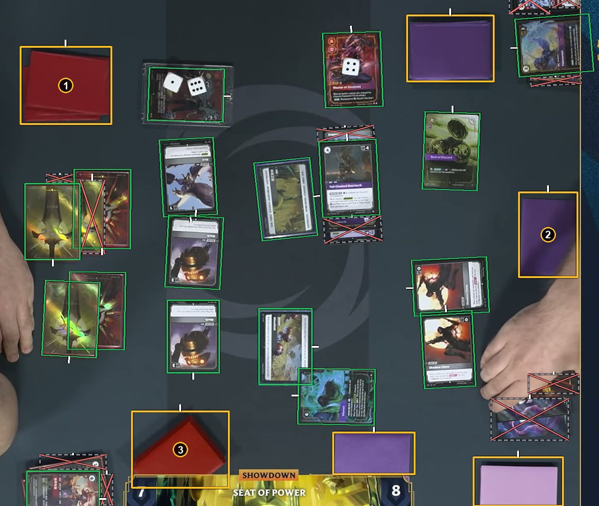

# Card backs

Each back gets a box. A neat deck gets one box, the top card's outline. A pile or any group of touching backs gets one box around the pile. A back standing alone gets its own box. See [How to label](https://github.com/ryangswe/riftsight-vision/blob/main/docs/labeling.md#card-backs).

Box 1 is a neat deck: one back box. Box 2 is a single face-down card: its own back box. Box 3 is a messy pile: one back box around the whole pile. The other orange boxes are backs too.
