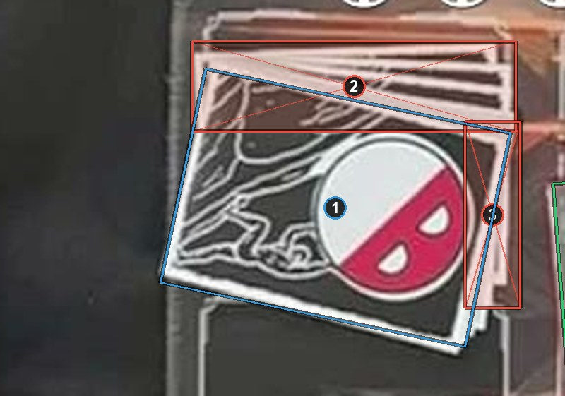

# A fan of backs

In a fan of backs, the back in front gets a back box if less than about half of it is hidden. The strips of the backs behind it go in an ignore box. Strips can share one box, as long as it does not cover most of the front back. See [How to label](https://github.com/ryangswe/riftsight-vision/blob/main/docs/labeling.md#card-backs).

Box 1 is the back in front, in an art sleeve. Art sleeves are still backs. The backs behind it show as strips along two sides. One box around both would cover most of box 1, so they get two ignore boxes, 2 and 3.

*No frame in the source data was labeled under this rule, so the boxes in this picture were redrawn for this guide.*
