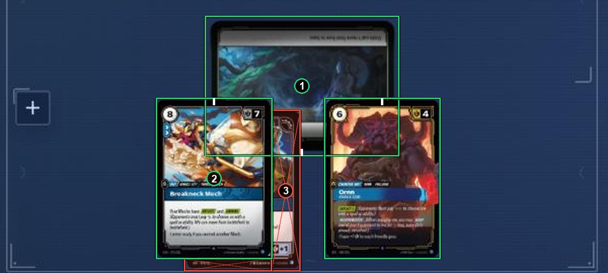
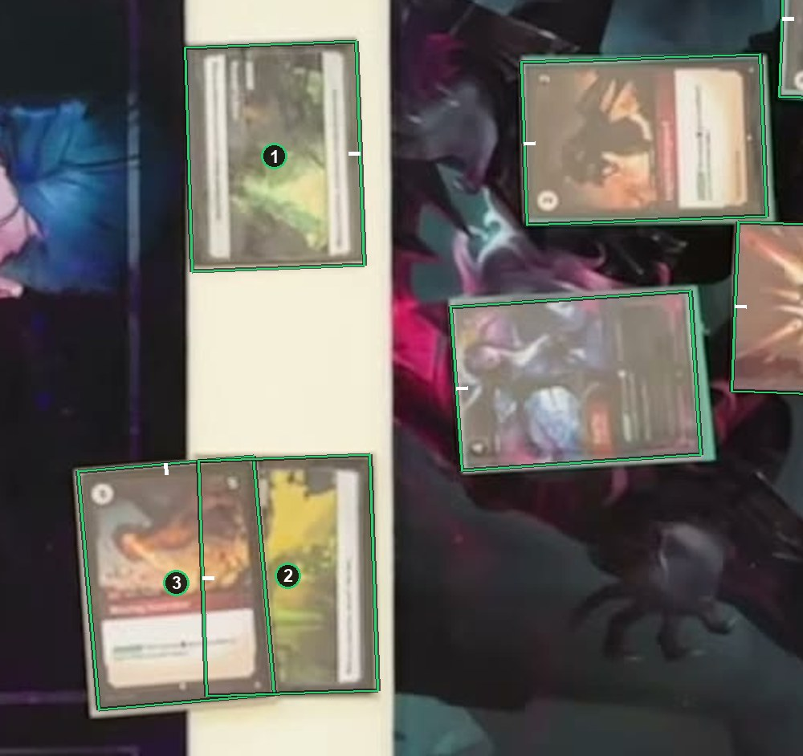

# Landscape cards and units on them

A landscape card, such as a battlefield, has its top on the edge its text reads along. A card on top of it is judged on its own. The landscape card gets a card box while less than about half of it is covered. See [How to label](https://github.com/ryangswe/riftsight-vision/blob/main/docs/labeling.md#stacks-fans-and-rows).

Box 1 is a battlefield. Its text reads upside down here, so its tick is on the bottom edge. Units cover about a third of it, so it keeps a card box around its whole outline. Box 2 is a unit standing on it. Box 3 and the thin box under box 2 are the visible parts of a card tucked under box 2.

*The saved labels for this frame follow an older rule, so the boxes in this picture were redrawn for this guide.*

Box 1 is a battlefield laid sideways. Its tick is on the edge its text reads along. Box 2 is another battlefield, and box 3 is a card lying on it. Box 3 covers less than half of box 2, so both get card boxes.
