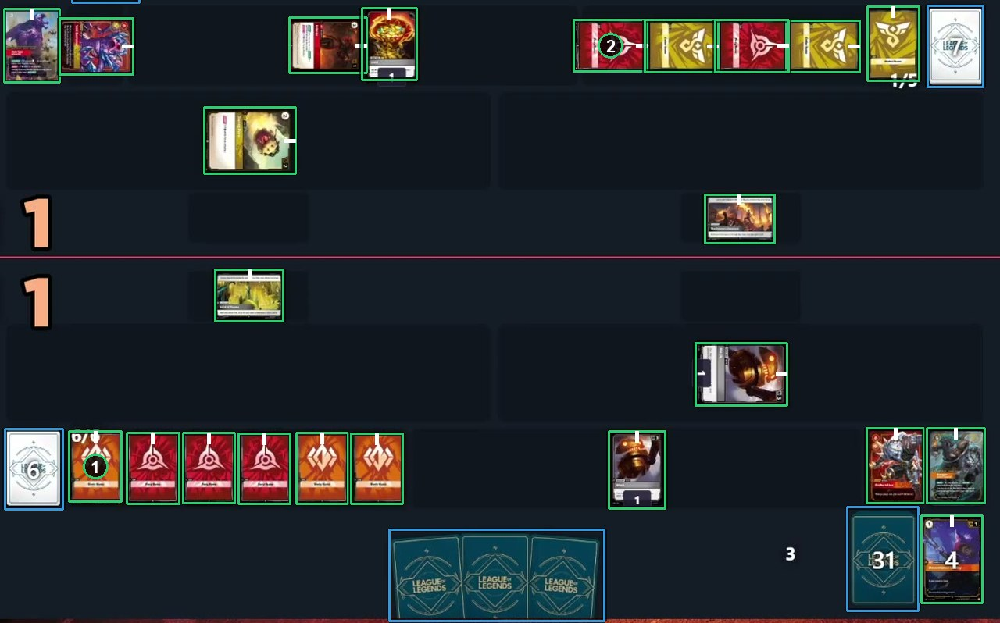
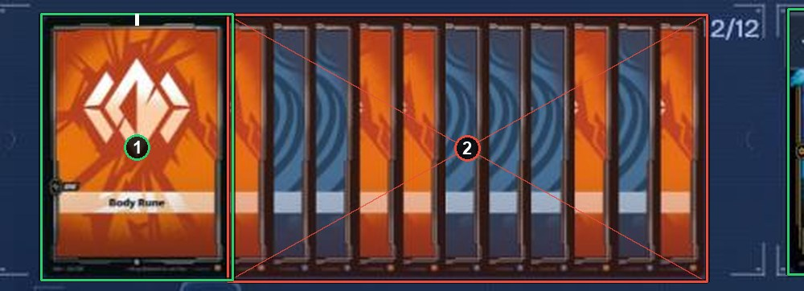

# Small cards side by side and in a tight run

Small cards side by side, not overlapping, are ordinary cards: one box each. In a tight run, a card that shows more than half of itself gets a card box, and the strips of the rest share one ignore box. See [How to label](https://github.com/ryangswe/riftsight-vision/blob/main/docs/labeling.md#stacks-fans-and-rows).

These are runes, Riftbound's small cards. Box 1 is one of six runes in a row, each with its own card box. Box 2 is one of four runes turned sideways, again one box each, with ticks on the side where each card's top is now.

Here twelve runes are stacked in a tight run. Box 1 is the rune in front, which shows its whole face: a card box. The other eleven show a strip each, and box 2 is one ignore box around all of them.

*The saved labels for this frame follow an older rule, so the boxes in this picture were redrawn for this guide.*
