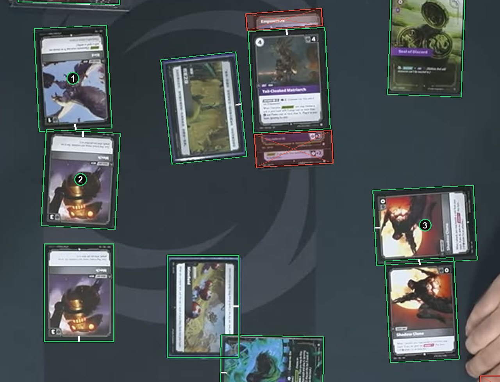

# Tokens

A token that is a card of the game, in your catalog and marked as a token, is boxed like other cards. A marker that is not a card, such as a die, a bead or a counter, gets no box. See [How to label](https://github.com/ryangswe/riftsight-vision/blob/main/docs/labeling.md#tokens).

Boxes 1, 2 and 3 are tokens: three different token cards from the game's catalog. Each gets a card box like the other cards around it.
