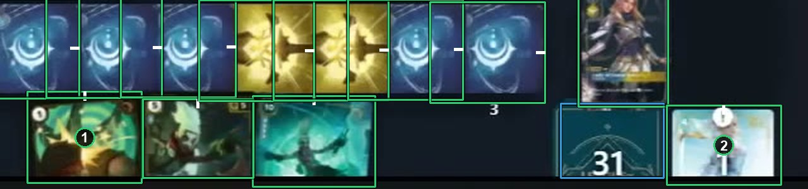

# Cards in a digital client's hand

Some clients draw the cards in hand cropped, with the picture and without the text. That is how the card always looks there, so box the visible part as a card, top edge up, and tag it `visibleShare: half`. See [How to label](https://github.com/ryangswe/riftsight-vision/blob/main/docs/labeling.md#cards-in-a-digital-clients-hand).

The bottom row is the player's hand in a digital client, drawn with the top half of each card. Box 1 and box 2 are card boxes around what the client shows, each tagged `visibleShare: half`. The full cards in the row above are runes, boxed as usual.
