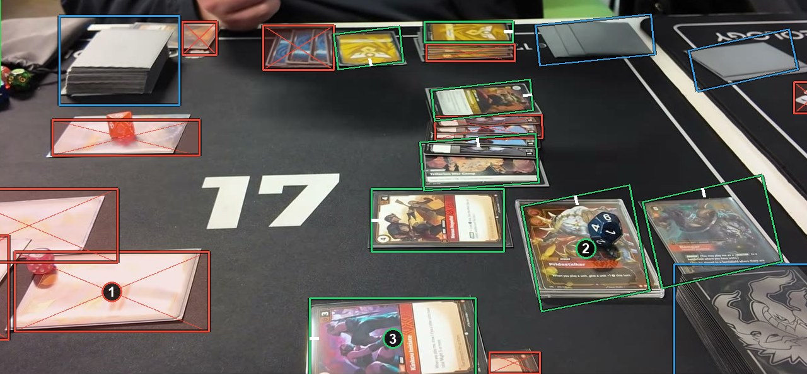

# Physical play: sleeves, glare, angles

Box the card, never its sleeve. Glare on part of a card is a small thing on it; glare that hides about half or more of the card, or its whole picture, makes an ignore box. A card seen at an angle gets the rotated rectangle that fits it most closely. See [How to label](https://github.com/ryangswe/riftsight-vision/blob/main/docs/labeling.md#physical-play).

This is a phone filming the table at an angle. Box 1 is washed out by glare, picture and all, so it gets an ignore box. Box 2 is a sleeved card with a die on it: a card box around the card. Box 3 is seen at an angle, so its box is the rotated rectangle that fits it most closely.
