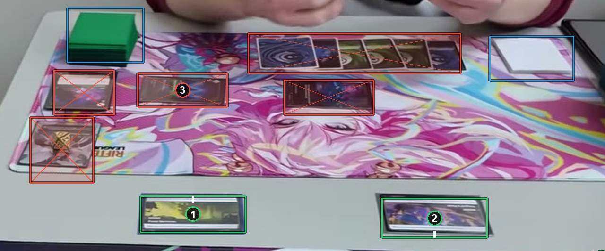

# Very small cards

A card too small for its picture to be made out is an ignore box. Frames where most cards are that small are better removed from the set than labeled. See [How to label](https://github.com/ryangswe/riftsight-vision/blob/main/docs/labeling.md#very-small-cards).

Box 1 and box 2 are battlefields about 45 pixels tall. They are small, but their pictures can still be made out, so they get card boxes. Box 3 is a card on the far side, about the same size, whose picture this labeler could not make out: an ignore box. Small cards are a judgment call, so be consistent.
