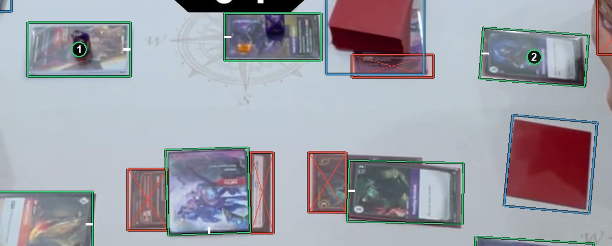

# A card nobody can name

A card nobody can name keeps its box. When naming, answer **Unknown card**: it is always allowed and always better than a guess. See [How to label](https://github.com/ryangswe/riftsight-vision/blob/main/docs/labeling.md#naming).

Box 1 is under glare and a die, and box 2 is dark and blurred. Nobody could name either card from this frame. Both keep their card boxes and are named Unknown.
