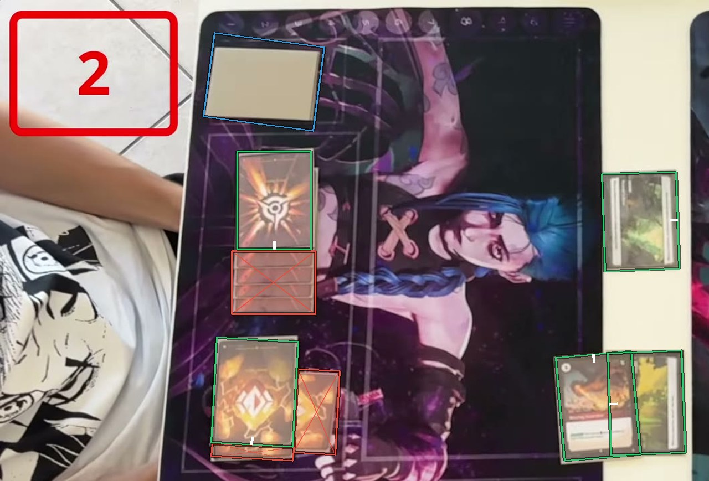

# Not a card

Dice, counters, the playmat, deck boxes, score graphics, the interface and webcams are not cards and get no box. See [How to label](https://github.com/ryangswe/riftsight-vision/blob/main/docs/labeling.md#what-gets-a-box).

The large character art is printed on the playmat. It is not a card, so it gets no box. The red score graphic at the top left and the player at the left get no box either. The cards on the mat are boxed as usual. For dice, see [case 01](../01-small-things-on-a-card/README.md).
